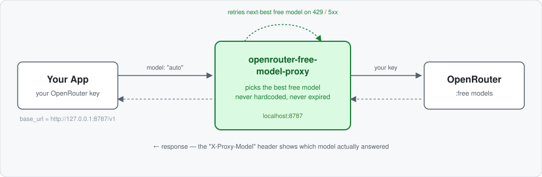

# openrouter-free-model-proxy

> [!IMPORTANT]
> This repository is very behind the more "niche" project I made which is the [https://github.com/GoSlowPoke168/hermes-openrouter-free-rotator](https://github.com/GoSlowPoke168/hermes-openrouter-free-rotator) which has many of the bug fixes that have not been synced to this more "general use" project yet.
>
> The goal of this project was to act as a API proxy so an application that needs an API key can simply point to this proxy url which automatically updates the Openrouter free model.
>
> If you are interested in continuing the development and improvement of this project, feel free to do so and create some PR's.

`openrouter-free-model-proxy` acts as an automatic router and manager for free OpenRouter models so you never have to worry about getting rate-limited or remembering to switch to a different model after one expires. This proxy makes that entirely someone else's problem: point your app at it, send `model: "auto"`, and it always assigns you the best free model available — re-ranking automatically as the catalogue changes, and falling back instantly to the next-best model if the one it picked fails. No model names to update, no expiration dates to watch.

It's a small local proxy that is compatible with any LLM SDK like the OpenAI Python SDK. Any app in any language can use it — you keep using your own OpenRouter key, you just change the `base_url`.



## How it works

1. Fetches OpenRouter's live `:free` catalogue and its real-world usage ranking.
2. Filters out models that are expiring soon, have poor uptime, or train on your prompts (see [privacy tiers](#privacy-tiers) below).
3. Caches the ranked result — built at startup, then rebuilt automatically once a day at 00:01 UTC, shortly after OpenRouter's free-tier quota resets (in the background, so requests never block on it). Models are dropped once they're within 1 day of expiring.
4. On each request, tries the top-ranked model; if it's rate-limited, down or times out, retries the next-best instantly — no manual intervention, no restart. Errors no other model could fix (bad key, no credits, invalid request) come straight back to you (see [errors](#errors)).

## Install

One line (clones to `~/openrouter-free-model-proxy`, runs it as a background service):

```bash
curl -fsSL https://raw.githubusercontent.com/GoSlowPoke168/openrouter-free-model-proxy/main/install.sh | bash
```

Or manually:

```bash
git clone https://github.com/GoSlowPoke168/openrouter-free-model-proxy
cd openrouter-free-model-proxy
python3 -m venv venv && ./venv/bin/pip install -r requirements.txt
./run_proxy.sh                 # foreground, or:
./install_service.sh           # background systemd --user service (survives logout)
```

Requires `python3` + `git`. Only dependency: `requests`. Set `NO_SERVICE=1` before the one-liner to skip the service.

**Service name:** `openrouter-free-model-proxy` (systemd `--user` unit). Useful commands:

```bash
systemctl --user restart openrouter-free-model-proxy   # reload after a config/code change
systemctl --user status openrouter-free-model-proxy
journalctl --user -u openrouter-free-model-proxy -f    # tail logs
```

## Use

Point your client at the proxy and send `model: "auto"`:

```python
from openai import OpenAI
client = OpenAI(base_url="http://127.0.0.1:8787/v1", api_key="<your OpenRouter key>")
client.chat.completions.create(model="auto", messages=[{"role":"user","content":"hi"}])
```

```bash
curl http://127.0.0.1:8787/v1/chat/completions \
  -H "Authorization: Bearer $OPENROUTER_API_KEY" \
  -d '{"model":"auto","messages":[{"role":"user","content":"hi"}]}'
```

The proxy forwards your key straight to OpenRouter (it stores nothing and never logs your key). Add `"stream": true` for token streaming. The response header `X-Proxy-Model` tells you which model actually answered (`X-Proxy-Fallback: true` if it wasn't the first pick).

### Privacy tiers

OpenRouter's free endpoints aren't all the same deal — each one is classified into one of three data-policy tiers:

| tier | what it means for your prompts |
|---|---|
| **private** | not used for training, not retained/logged |
| **logs** | not used for training, but retained/logged (e.g. for abuse monitoring) |
| **trains** | may be used to train future models |

A model whose privacy tier couldn't be determined is never auto-selected.

### Modes

A **mode** decides which tiers may be auto-selected, and whether privacy or popularity wins when they disagree:

| mode | selectable tiers | order |
|---|---|---|
| `strict` | private | rank |
| `balanced` *(default)* | private, logs | every `private` model before any `logs` one |
| `relaxed` | private, logs | best rank wins, regardless of tier |
| `loose` | private, logs, **trains** | best rank wins — only use this if you're fine with a model that may train on your prompts |

`balanced` and `relaxed` allow the same models and differ only in ordering. The default comes from `defaults.mode` in config.

### Model strings

| value | behaviour |
|---|---|
| `auto` | best free model right now, under the default mode |
| `auto:strict` / `auto:balanced` / `auto:relaxed` / `auto:loose` | pick a mode for this request |
| `auto:private` / `auto:logs` / `auto:any` | older names, still accepted: `strict` / `balanced` / `loose` |
| `auto:tools` / `auto:notools` | require / don't require tool-calling support |
| `auto:tools,strict` | combine flags (conflicting modes resolve to the strictest) |
| `smart`, `fast` | your own aliases (see config) |
| `vendor/model` | that exact model, passed through unchanged (free or paid) |
| `vendor/model,auto` | that model, but fall back to `auto` if it fails (`vendor/model,auto:strict` also works) |
| anything else without a `/` (e.g. `gpt-4o`) | treated as `auto` |

An unknown flag (e.g. a typo like `auto:privte`) is rejected with a 400 rather than silently ignored.

Flags also work as headers: `X-Proxy-Require-Tools: true`, `X-Proxy-Privacy: <mode>` (`private` and `any` also accepted). Sending a `tools` array requires tool support automatically.

### Errors

| what happened | what the proxy does |
|---|---|
| rate limit (429), outage (5xx), timeout, model gone (404), or a 200 that carries an error | tries the next model |
| bad key (401), no credits (402), moderation (403), invalid request (400) | returns OpenRouter's error to you immediately — another model would fail the same way |
| every model rate-limited | `429` with per-model `details` |
| every model failed, mixed reasons | `502` with per-model `details` |

When streaming, the proxy waits for the first data event before sending anything, so a failure reported at the very start of a stream still falls back. Once tokens are flowing, a failure ends the stream — it can't switch models mid-answer.

### Endpoints (no key needed except the completion)

| method | path | what |
|---|---|---|
| POST | `/v1/chat/completions` | the proxy (needs your key) |
| GET  | `/models` | ranked free models with tier / uptime / tools / reason |
| GET  | `/v1/models` | same list, OpenAI `{data:[{id}]}` shape |
| GET  | `/status` | cache age + current top pick (never triggers a rebuild) |

```bash
curl http://127.0.0.1:8787/models              # browse the ranked free models
curl 'http://127.0.0.1:8787/models?tools=1'     # only tool-capable
curl 'http://127.0.0.1:8787/models?mode=loose'  # rank under another mode (any=1 still works)
curl 'http://127.0.0.1:8787/models?refresh=1'   # force a fresh scrape
```

## Configure — `config.json`

Values here are **defaults**; a request can override them per-call — unless the policy is in `locked`, then requests can only make it stricter, never looser.

```json
{
  "host": "127.0.0.1",
  "port": 8787,
  "ttl_seconds": 86400,         // on-demand safety net only — see daily_refresh_at
  "daily_refresh_at": "00:01",  // HH:MM UTC the ranked list is rebuilt
  "cascade_depth": 5,           // models to try before giving up
  "request_timeout": 120,
  "defaults":  { "require_tools": false, "mode": "balanced" },
  "locked":    [],              // e.g. ["mode"] so no request can pick a looser mode
  "denylist":  { "models": [], "providers": [] },   // drop these from the cascade
  "aliases":   { "smart": "auto:strict", "fast": "auto" },
  "last_resort_model": null     // null → return 503 when no free model qualifies
}
```

- **denylist** — exclude specific models or endpoint-providers (e.g. `"providers": ["Google AI Studio"]` to avoid free endpoints backed by an already-rate-limited upstream).
- **locked** — turn a default into a hard policy nothing can loosen (`"mode"`, `"require_tools"`).
- Older configs using `require_private` / `allow_trains` still work: they map to `strict` / `loose`, and locking either one locks `mode`.
- An invalid `config.json` or unknown mode stops the proxy at startup instead of silently falling back to defaults.
- **last_resort_model** — off by default (so it's always $0); set a paid model to avoid a hard 503 when no free model is healthy.

## Scope

`POST /v1/chat/completions` only (no legacy completions/embeddings yet). Binds localhost by default; widen `host` at your own risk (no TLS built in). Billing is whatever OpenRouter tracks against the key you send. The ranking/privacy logic is lifted from the sibling project [`hermes-openrouter-free-rotator`](https://github.com/GoSlowPoke168/hermes-openrouter-free-rotator).

## Codebase

```
install.sh          internet installer (clone → venv → service)
install_service.sh  register the systemd --user service
run_proxy.sh        run the server directly
proxy.py            HTTP server: routing, pass-through auth, cascade, streaming
ranker.py           builds + caches the ranked free-model list (the "brain")
selection.py        pure ranking + privacy-tier logic
openrouter.py       unauthenticated OpenRouter data fetchers
config.json         defaults / policies / denylist / aliases
tests/              pytest suite (pip install -r requirements-dev.txt; python -m pytest)
```
